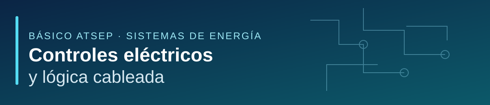

<div align="center">



### Del plano al simulador; del simulador al circuito real

**Curso Básico ATSEP · Sistemas de Energía · CEA — Aeronáutica Civil**  
**Material académico: Marco Teran**


[**📘 Guía PDF**](guia/guia_laboratorio_ESP32_ATSEP.pdf) · [**⬇️ Descargar .ino**](firmware/banco_simple_esp32.ino) · [**🎓 Diapositivas PDF**](presentaciones/controles_electricos_y_logica_cableada.pdf) · [**🧪 Simulador**](https://github.com/marcoteran/atsep-controllogyc) · [**🌐 Portal de la clase**](docs/index.html)

</div>

---

## Tu recorrido de aprendizaje

Este repositorio reúne **las tres piezas de una misma experiencia**: la presentación teórica, el [simulador interactivo](https://github.com/marcoteran/atsep-controllogyc) y un banco físico con **ESP32 + 74HC08**. No son tres cursos independientes: se refuerzan mutuamente.

> **Pregunta guía:** si falla la red eléctrica durante una aproximación nocturna, ¿cómo se decide cuándo cambiar a la planta de respaldo evitando conectar ambas fuentes a la vez?

### Empieza aquí

| Recurso | ¿Qué encontrarás? | Acceso |
|:--|:--|:--|
| **01 · Presentación teórica** | 235 páginas: mando y potencia, contactores, lógica cableada, temporizadores, enclavamientos y transferencia. | [Ver / descargar PDF](presentaciones/controles_electricos_y_logica_cableada.pdf) |
| **02 · Simulador interactivo** | Once módulos para experimentar con circuitos y comprobar hipótesis. Es un **repositorio independiente**. | [Abrir repositorio del simulador](https://github.com/marcoteran/atsep-controllogyc) |
| **03 · Laboratorio físico** | Guía paso a paso de 3 horas, circuitos, cálculos, tablas y evidencias. | [Descargar guía PDF](guia/guia_laboratorio_ESP32_ATSEP.pdf) |
| **04 · Programa para ESP32** | Código Arduino `.ino` que implementa los modos 1–4 y las pruebas `b` y `k`. | [Descargar archivo `.ino`](firmware/banco_simple_esp32.ino) |

**Sin Internet en el aula:** el PDF de laboratorio incorpora el `.ino` como archivo adjunto (icono de clip y panel de adjuntos), que se puede extraer en un lector PDF compatible. También ofrece un hipervínculo de descarga desde GitHub; en repositorios privados se requieren permisos.

## Cuatro prácticas, una sola construcción progresiva

| Práctica | Tiempo | Aprenderás a… | Simulador relacionado | Teoría de apoyo |
|:--|--:|:--|:--|:--|
| **1. LED y resistencia** | 25 min | Calcular corriente, montar, medir y distinguir mando de potencia | [Mando vs. potencia](https://github.com/marcoteran/atsep-controllogyc/tree/master/components/modules/mando-potencia.tsx) | [Conceptos iniciales](presentaciones/controles_electricos_y_logica_cableada.pdf#page=15) |
| **2. Pulsador e interruptor** | 35 min | Reconocer entradas digitales, polarización pull-up/pull-down y posición de contactos | [Mandos y señalización](https://github.com/marcoteran/atsep-controllogyc/tree/master/components/modules/mandos.tsx) | [Elementos de mando](presentaciones/controles_electricos_y_logica_cableada.pdf#page=79) |
| **3. Marcha–paro y retención** | 45 min | Comprender memoria de marcha e inhibición hardware mediante 74HC08 | [Lógica y retención](https://github.com/marcoteran/atsep-controllogyc/tree/master/components/modules/logica.tsx) | [Autoenclavamiento](presentaciones/controles_electricos_y_logica_cableada.pdf#page=100) |
| **4. Red–planta** | 40 min | Confirmar fallas, temporizar, transferir e identificar la ausencia de enclavamiento cruzado | [Enclavamientos](https://github.com/marcoteran/atsep-controllogyc/tree/master/components/modules/enclavamientos.tsx) · [Transferencia](https://github.com/marcoteran/atsep-controllogyc/tree/master/components/modules/transferencia.tsx) | [Transferencia](presentaciones/controles_electricos_y_logica_cableada.pdf#page=178) |

Los tiempos anteriores no incluyen **20 min de preparación** ni **15 min de cierre**: total **180 min**. Todos los ejemplos emplean LEDs de 3,3 V para **simular órdenes de mando**; no controlan cargas de potencia reales.

### ¿Cómo se abre el simulador?

El simulador es una **aplicación web independiente en otro repositorio**, no un programa incluido dentro de este ZIP. Para ejecutarlo localmente con Node.js y pnpm:

```bash
git clone https://github.com/marcoteran/atsep-controllogyc.git
cd atsep-controllogyc
corepack enable
pnpm install
pnpm dev
```

Luego abra `http://localhost:3000` y seleccione los módulos **Mandos**, **Lógica**, **Temporizadores**, **Enclavamientos** o **Transferencia**. Requiere permisos para acceder al repositorio privado.

## Descargas directas

- 📗 **[Guía del laboratorio (PDF)](guia/guia_laboratorio_ESP32_ATSEP.pdf)** — incluye código completo y anexo de conexiones.
- 🔧 **[Programa para Arduino IDE (.ino)](firmware/banco_simple_esp32.ino)** — se carga en el ESP32.
- 📊 **[Presentación de la clase (PDF, 235 páginas)](presentaciones/controles_electricos_y_logica_cableada.pdf)** — documento aportado por el docente.
- 📝 **[Fuente LaTeX editable (.tex)](guia/guia_laboratorio_ESP32_ATSEP.tex)** — permite mantener el material académico.

> Para descargar un archivo desde GitHub, ábrelo y selecciona **Download raw**. Dado el tamaño de la presentación (cerca de 40 MiB), es preferible descargarla en lugar de depender de la vista previa en GitHub. La extensión `.ino` es un archivo de código Arduino, no un PDF.

## Antes de comenzar

**Necesitas:** una placa ESP32 DevKitC compatible, protoboard, 74HC08, pulsadores, DIP, tres LEDs, resistencias, un condensador de 100 nF, cables y multímetro. Comprueba la lista exacta en la guía, junto con el pinout de tu tarjeta real. Instala el [Arduino IDE](https://www.arduino.cc/en/software) y el soporte de placas ESP32 correspondiente.

1. Abre el PDF y revisa la introducción y las reglas de seguridad.
2. Descarga `firmware/banco_simple_esp32.ino`, ábrelo en Arduino IDE y selecciona tu placa ESP32.
3. Carga el programa, abre el **Monitor serie a 115200 baudios** y sigue las prácticas en secuencia (`1`, `2`, `3`, `4`).
4. Compara cada montaje con los módulos del simulador antes de energizarlo.
5. Entrega una foto final, las tablas diligenciadas y las tres respuestas del cierre.

> ⚠️ **Seguridad:** únicamente USB y 3,3 V. No conectes al banco red eléctrica, generador real ni bobinas de contactores. La compuerta AND no es un paro de emergencia certificado ni impide por sí misma el solape entre KM1 y KM2.

## ¿Dónde está cada cosa?

```text
atsep-energy-control-labs/
├── README.md                         ← Página de entrada para estudiantes
├── assets/banner.svg                 ← Identidad visual
├── presentaciones/
│   └── controles_electricos_y_logica_cableada.pdf
├── guia/
│   ├── guia_laboratorio_ESP32_ATSEP.pdf
│   └── guia_laboratorio_ESP32_ATSEP.tex
├── firmware/
│   ├── banco_simple_esp32.ino
│   └── README.md
├── docs/
│   ├── index.html                    ← Portal de curso listo para GitHub Pages
│   ├── para-estudiantes.md
│   ├── para-docentes.md
│   └── mapa-de-clases.md
├── scripts/                           ← Compilar y publicar
├── tests/                             ← Revisión reproducible
└── .github/workflows/                ← Validaciones automáticas
```

## Para docentes y colaboradores

[**Ruta pedagógica**](docs/mapa-de-clases.md) · [**Guía del instructor**](docs/para-docentes.md) · [**Instrucciones de compilación**](guia/README.md) · [**Publicación en GitHub**](PUBLICAR_EN_GITHUB.md)

La presentación es un archivo académico de autoría del docente; **su presencia en este repositorio no constituye una licencia de redistribución comercial**. Si el repositorio es privado, invite explícitamente a los estudiantes que necesiten acceder a los archivos.

---

<div align="center"><sub>Material de enseñanza · Centro de Estudios Aeronáuticos · Básico ATSEP, Sistemas de Energía · Marco Teran · 2026</sub></div>